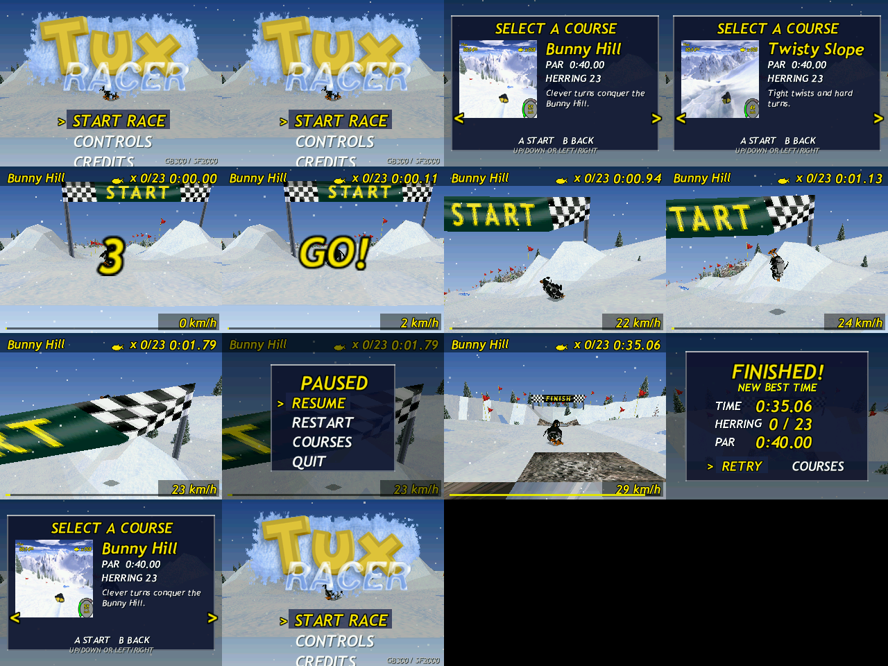

# FroggyTuxRacer (Tux Racer for GB300 & Data Frog SF2000)

[](COPYING)
[]()
[]()

A dedicated source port of the classic 3D downhill racing game **Tux Racer** (originally by Jasmin F. Patry / Sunspire Studios) crafted specifically for the ultra-budget **Data Frog SF2000** and **GB300 / GB300V2** handheld consoles.

Featuring a custom-built, highly optimized pure fixed-point 3D software rasterizer tailored for MIPS32 processors lacking a hardware floating-point unit (FPU), running at 320x240 RGB565.

<p align="center">
  
</p>

---

## Features

- **Custom Fixed-Point 3D Software Engine**: Built from the ground up for MIPS32 with `-msoft-float`. Zero FPU instructions (`CPR1 size: 0`).
- **Original 3D Tux Model**: Restored full 3D penguin model baked directly from original `tux.tcl` hierarchical geometry (34 spheres, 86 nodes), supporting active sliding on stomach, turning, jumping, and steering.
- **Adaptive Terrain LOD**: Full 2-meter terrain resolution near the camera blended smoothly into 4-meter cells at distance, preserving crisp slopes without sacrificing framerate.
- **5 Classic Tracks**:
  - *Bunny Hill*
  - *Twisty Slope*
  - *Bumpy Ride*
  - *Frozen River*
  - *Path of Daggers*
- **Faithful Gameplay**: Gravity slope acceleration, surface friction (snow, ice, rock), tree collisions, jump physics, active paddling, and brake controls.
- **Collectibles & Gates**: Herring items properly disappear upon collection and award points; 3D start/finish banners and course boundary flags.
- **Track Selection & In-Game Pause**: Switch tracks directly from the course select screen or through the `COURSES` menu option in the in-game pause menu.
- **Persistent High Scores**: Best times saved to SD card (`tuxracer.sav`).
- **Sound Effects**: 44.1 kHz multi-channel mixer playing original Tux Racer sound effects (sliding on snow/ice/rock, fish pickups, tree collisions, jumps).

---

## Controls

| Button | Action |
|---|---|
| **D-Pad Left / Right** | Steer |
| **D-Pad Up** | Paddle / Accelerate |
| **D-Pad Down** | Brake |
| **A** | Jump / Confirm in menus |
| **B** | Back in menus |
| **L / R (Bumper)** | Previous / Next course in menu |
| **START** | Pause / Resume |
| **SELECT** | Reset to checkpoint |

---

## Installation Guide

### Option 1: Quick Install via Release Zip (Recommended)

1. Download the release archive for your console from [Releases](https://github.com/synaps33/froggytuxracer/releases):
   - `tuxracer-gb300-sd.zip` for **GB300 / GB300V2**
   - `tuxracer-sf2000-sd.zip` for **Data Frog SF2000**
2. Insert your console's microSD card into your PC.
3. Extract the contents of the zip file directly to the **root** of your microSD card.
4. Safely eject the card, insert it into your console, and launch **TuxRacer** from the **GBA** games list (`ROMS/TuxRacer.gba`).

### Directory Structure on MicroSD Card

```
[SD Root]/
├── ROMS/
│   ├── TuxRacer.gba                   <- Game launch stub
│   ├── TuxRacer.rgb565                <- Menu thumbnail
│   ├── .res/
│   │   └── TuxRacer.rgb565
│   └── tuxracer/                      <- Game asset folder (~4.7 MB)
│       ├── TuxRacer.gba
│       ├── core_87000000
│       ├── courses.idx
│       ├── course/                    <- Heightfields & track definitions (.trk)
│       ├── font/                      <- Font metrics (.fnt)
│       ├── model/                     <- 3D Tux mesh data (.bin)
│       ├── sfx/                       <- Audio samples (.snd)
│       ├── tex/                       <- 16-bit textures (.tex)
│       └── .res/
├── system/
│   └── Deimos/
│       └── cores/
│           ├── tuxracer.gb3k          <- Core binary (GB300)
│           └── tuxracer.sf2k          <- Core binary (SF2000)
├── cores/
│   └── tuxracer/
│       └── core_87000000
└── configs/
    └── custom_cores/
        └── tuxracer/
            └── games.opt              <- Core mapping configuration
```

---

### Option 2: Automated Installation from Source (Linux)

If your SD card is mounted on your PC:

```bash
# Auto-detects SD mount under /media or /mnt
./install_to_sd.sh /media/$USER/GB300
```

The script automatically detects whether your target is GB300 or SF2000, deploys the core, converts/copies all assets, writes launcher stubs, and installs menu thumbnails.

---

## Building from Source

### Prerequisites

- Standard build tools (`make`, `gcc`, `ffmpeg`, `python3`, `PIL/Pillow`)
- MIPS ELF toolchain (`mipsel-mti-elf-gcc`) for console cores
- MIPS Musl toolchain (`mipsel-linux-muslsf-gcc`) and `qemu-mipsel` for emulator tests

### Build Targets

```bash
# Build native PC test runner
make

# Run headless test suite and generate PNG screenshots
make test

# Run all 5 course startups and generate course preview contact sheet
make test-courses

# Run long soak test (autonomous downhill simulation)
make soak

# Build and test MIPS32 soft-float binary under QEMU
make mips
make test-mips

# Build production console cores and generate distribution packages
make device
```

---

## Technical Performance

- **Host (x86_64, Linux)**: ~5.8 ms/frame (~170+ FPS).
- **MIPS32 QEMU Emulation**: ~23–25 ms/frame (~40–45 FPS under emulation).
- **Bit-for-Bit Determinism**: 14/14 rendering checkpoints and audio sample batches are byte-identical between x86_64 and MIPS32 soft-float targets.
- For complete benchmarking data, please see [TEST_REPORT.md](TEST_REPORT.md).

---

## Credits & License

- **Synaps33** — Port, software fixed-point 3D engine, and tooling for GB300 & SF2000.
- **Jasmin F. Patry / Sunspire Studios** — Original Tux Racer game and assets (GPL-2.0).
- Tux the Penguin is originally by Larry Ewing.
- Licensed under the **GNU General Public License v2.0**. See [COPYING](COPYING) for details.
